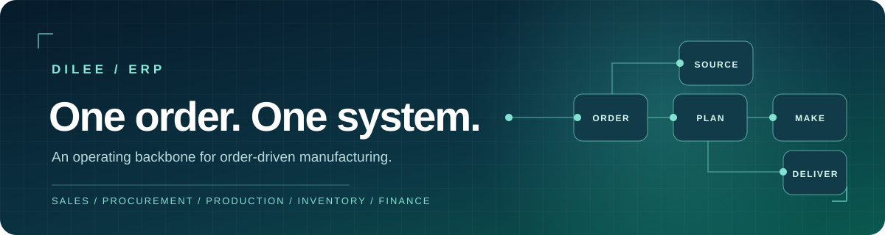
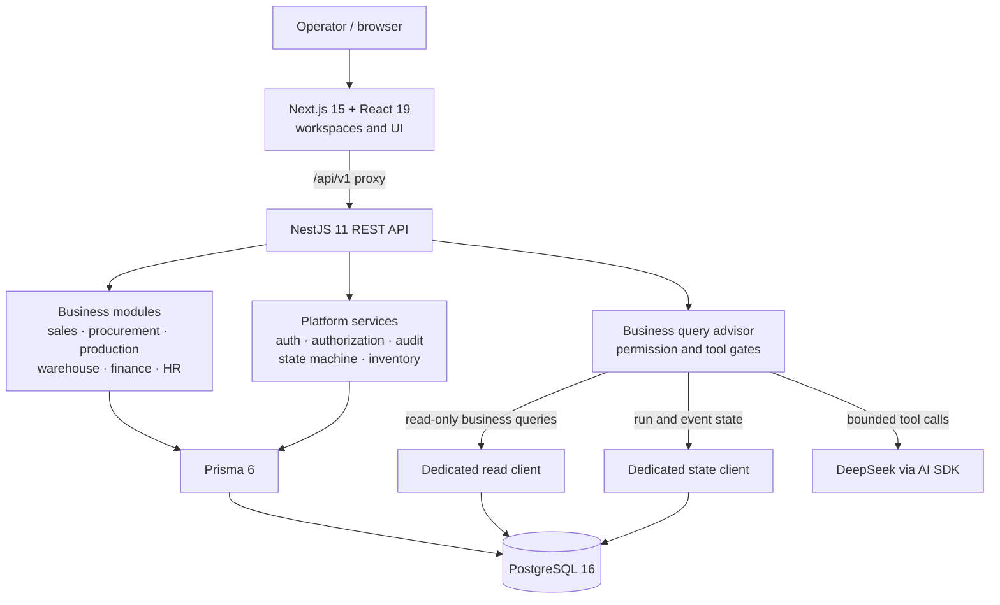
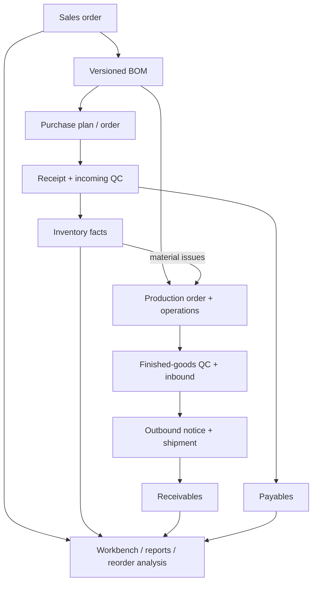

<p align="center"></p>

<h1 align="center">Dilee ERP</h1>

<p align="center"><strong>An order-centered operating backbone for manufacturing teams.</strong></p>

<p align="center">From customer order and BOM to purchasing, production, quality control, warehouse movements, and financial settlement: one connected operational record.</p>

<p align="center"><a href="#system-architecture">Architecture</a> · <a href="#engineering-highlights">Engineering</a> · <a href="#developer-quick-start">Quick Start</a> · <a href="#product-journey">Product Journey</a></p>

<p align="center">
  
  
  
  
  
  
  
  
</p>

## What Dilee connects

The sales order is the business anchor. Dilee links its material requirements and production work to purchase orders, inspections, stock movements, shipments, receivables, and payables. Teams can follow a document back to the order that caused it, while workbench views and reports assemble the wider picture.

| Workspace | Operational scope |
| --- | --- |
| Sales & customers | Customer records, sales orders, versioned BOMs, outbound notices |
| Procurement | Supplier and material masters, purchase plans, orders, receipts |
| Production | Production orders, operations, daily reports, material issue and replenishment |
| Quality & warehouse | Incoming and finished-goods inspection, inventory facts, stocktake, inbound and outbound |
| Finance & HR | Receivables, payables, cash flow, vouchers, employees, attendance, payroll |
| Intelligence | Order workbench, reports, alerts, reorder analysis, and a read-only business query advisor |

## System Architecture

**The web app sends same-origin API requests through Next.js; NestJS owns business rules and persistence, while the advisor has separate data and state paths.**



The production Compose setup runs `web`, `api`, and `postgres` as separate services. The advisor's read and state credentials are required in production; local development can use the regular database connection with the fake model provider. See [the Compose definition](docker-compose.yml) and [advisor module wiring](apps/api/src/modules/business-query-agent/business-query-agent.module.ts).

### Architecture Overview

**The order connects planning, execution, stock, and settlement; inventory movements provide the quantity record.**



## Engineering Highlights

| Decision | Why it matters | Implementation |
| --- | --- | --- |
| **Order identity survives document edits** | A change to a human-readable order number must not silently disconnect downstream records. The project added `sales_order_id` links across the document chain and an autofill trigger for writes. | [Prisma schema](apps/api/prisma/schema.prisma) · [migration history](apps/api/prisma/migrations) · [linkage test](apps/api/test) |
| **Stock is derived from movement facts** | Inbound, outbound, and correction events remain inspectable; balances are aggregated from `InventoryFact` instead of being treated as an isolated mutable number. | [Inventory service](apps/api/src/platform/inventory/inventory.service.ts) · [data model](apps/api/prisma/schema.prisma) |
| **Business query is constrained at two boundaries** | The model can call registered read tools, but it cannot issue arbitrary SQL or write business records. Production uses separate credentials for business reads and `agent_*` state; permissions are checked again at tool execution. | [Advisor module](apps/api/src/modules/business-query-agent/business-query-agent.module.ts) · [tool executor](apps/api/src/modules/business-query-agent/tools/tool-executor.ts) · [environment checks](apps/api/src/platform/config/validate-environment.ts) |
| **The API has a consistent contract** | Global validation, response envelopes, error handling, request IDs, and audit attribution give feature modules shared behavior. | [API bootstrap](apps/api/src/main.ts) · [platform modules](apps/api/src/platform) |
| **CI tests the actual chain** | A fast typecheck and unit gate is followed by PostgreSQL integration, HTTP contract, and browser E2E tests. | [Test workflow](.github/workflows/test.yml) · [test strategy](docs/test/README.md) |

## Repository Map

```text
Dilee/
├── apps/
│   ├── api/                  NestJS API, Prisma schema and migrations
│   │   └── src/
│   │       ├── modules/      Business capabilities and advisor
│   │       └── platform/     Auth, audit, inventory, HTTP contracts
│   └── web/                  Next.js routes, features, components and UI tests
├── docs/                     Product decisions, design, tasks and test evidence
├── scripts/                  Database, verification, release and deployment tools
├── tests/                    Cross-service fixtures and browser E2E tests
├── .github/workflows/        Fast and chain CI gates
└── docker-compose.yml        Web + API + PostgreSQL deployment topology
```

## Developer Quick Start

**Prerequisites:** Node.js 22, npm 11, and Docker with Compose. The commands below start PostgreSQL in Docker and run the application locally.

1. Install dependencies and create a local environment file:

   ```bash
   npm ci
   cp .env.example .env
   ```

   On Windows PowerShell, use `Copy-Item .env.example .env` instead of `cp` if needed. In `.env`, set a strong `POSTGRES_PASSWORD` and an `INITIAL_ADMIN_PASSWORD` of at least 10 characters containing letters and numbers. Set `DATABASE_URL` to `postgresql://dilee:<your-password>@localhost:5432/dilee_erp?schema=public`. For local development, remove `AGENT_READ_DATABASE_URL` and `AGENT_STATE_DATABASE_URL` from the copied example, and set `AGENT_LLM_PROVIDER=fake` so the advisor uses its local test provider. After editing, copy `.env` to `apps/api/.env`; the API development command runs from that workspace and reads its environment file there.

   ```bash
   cp .env apps/api/.env
   ```

2. Start the database, apply migrations, and seed the administrator and reference data:

   ```bash
   npm run db:up
   npx prisma generate --schema apps/api/prisma/schema.prisma
   npx prisma migrate deploy --schema apps/api/prisma/schema.prisma
   node --env-file=.env --import tsx apps/api/prisma/seed.ts
   ```

3. Start the services in **separate terminals**:

   ```bash
   npm run dev --workspace=@dilee/api
   ```

   ```bash
   npm run dev --workspace=@dilee/web
   ```

4. Open [http://localhost:3000](http://localhost:3000) and sign in with the `INITIAL_ADMIN_USERNAME` and `INITIAL_ADMIN_PASSWORD` from `.env`. The API health endpoint is [http://localhost:3001/api/v1/health](http://localhost:3001/api/v1/health).

Run the fast verification gate with `npm run verify:quick`. The full chain also needs a dedicated test database; see the [test workspace](docs/test/README.md).

## Product Journey

The milestones below are drawn from the repository's commit history. They show how the product moved from a platform skeleton to a connected manufacturing workflow and then to stronger data and query boundaries.

| When | Milestone | Evidence |
| --- | --- | --- |
| **19 Aug 2026** | Product requirements and a two-workspace foundation established the API contract, authentication, authorization, audit, state machine, and web shell. | [`d3a96ab`](https://github.com/yejianqin61-cell/DileeErp/commit/d3a96ab) · [`901f9b7`](https://github.com/yejianqin61-cell/DileeErp/commit/901f9b7) |
| **21 Aug 2026** | The first end-to-end sales and purchasing chain connected customer orders, versioned BOMs, purchase receipts, incoming inspection, and raw-material inbound facts. | [`b14ccb1`](https://github.com/yejianqin61-cell/DileeErp/commit/b14ccb1) · [`64ebd1c`](https://github.com/yejianqin61-cell/DileeErp/commit/64ebd1c) · [`f6fb63f`](https://github.com/yejianqin61-cell/DileeErp/commit/f6fb63f) |
| **Late Aug–mid Sep 2026** | Production operations, daily reports, material issues, finished-goods QC and outbound flows joined the chain; finance expanded into receivables, payables, cash flow and vouchers. | [`723f9ad`](https://github.com/yejianqin61-cell/DileeErp/commit/723f9ad) · [`7713ddb`](https://github.com/yejianqin61-cell/DileeErp/commit/7713ddb) · [`3d7c394`](https://github.com/yejianqin61-cell/DileeErp/commit/3d7c394) |
| **29–30 Sep 2026** | Reorder analysis connected item history across batches; order-number editing gained an impact confirmation for the full document chain. | [`e193816`](https://github.com/yejianqin61-cell/DileeErp/commit/e193816) · [`716803c`](https://github.com/yejianqin61-cell/DileeErp/commit/716803c) |
| **26–27 Oct 2026** | The Dilee Advisor gained bounded read tools and a dedicated UI; order references and database foreign keys strengthened cross-document lookup and identity. | [`086dac7`](https://github.com/yejianqin61-cell/DileeErp/commit/086dac7) · [`0ca25e5`](https://github.com/yejianqin61-cell/DileeErp/commit/0ca25e5) · [`f56e336`](https://github.com/yejianqin61-cell/DileeErp/commit/f56e336) |
| **29 Oct 2026** | Production material issue forms and detail views were aligned with the printed document's four quantity fields. | [`ec9435d`](https://github.com/yejianqin61-cell/DileeErp/commit/ec9435d) · [`4ee33a1`](https://github.com/yejianqin61-cell/DileeErp/commit/4ee33a1) |

## Star Trend

[](https://star-history.com/#yejianqin61-cell/DileeErp&Date)

The chart reflects public GitHub stars and updates independently of this README. If no stars have been recorded yet, it will appear empty; the live count is shown in the badge above.

---

For deeper implementation context, start with the [product capability catalog](docs/product/module-capability-catalog.md), [design workspace](docs/design/README.md), and [test workspace](docs/test/README.md).
