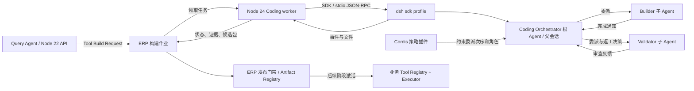

# DeepSeekHarness SDK 接入与复用：阶段一方案

> 2026-10-29 建立；2026-10-30 增补母 Agent 编排｜状态：源码核查完成，运行验证待执行｜上游固定提交 `f3803c96974ad4a94195fb97e5c637e9c2a3afe3`（`0.2.2-alpha.2`）
>
> 产品决策来自[自生成工具架构](business-query-agent-generated-tools-architecture-2026-10-29.md)。上游逐项证据见[源码核查笔记](deepseek-harness-sdk-2026-10-29.md)。本文件是接入设计，不代表 SDK 已在 ERP 中跑通。

## 决定

阶段一采用**独立 Node 24 Coding worker + `@deepseek-ai/dsh-sdk-client` + 同版 `dsh` CLI**。worker 为每个构建批次启动一套 Harness runtime，读取受控 ERP 源码视图，仅向工具候选目录写产物。Harness 的**根 Agent 作为 Coding Orchestrator 母 Agent**，理解需求、拆分能力并决定 Builder/Validator 的委派与返工；Cordis 插件约束执行次序，Worker 和 ERP 独立验证发布证据。当前 NestJS API 继续用 Node 22，Query Agent 的模型 provider 和既有静态工具链在阶段一不替换。

先做一个脱敏业务缺口的纵切实验，证明 Builder 编写、Validator 独立审查、测试、权限核验和越界阻断。多工具并行的最小实验也在阶段一完成；持久等待、自动发布和前端拓扑仍按[总计划](business-query-agent-generated-tools-plan-2026-10-29.md)后续阶段接入。

## 已核实的架构与接入边界

- SDK `DeepSeekHarness` 是**进程外客户端**，不是可导入 NestJS 的 Agent 内核。它懒启动同版 `dsh --profile sdk`，通过 stdio JSON-RPC 驱动会话；`run()` 等到根 Agent 下一次 idle，`session/wait` 才覆盖受管理的后代。[SDK README](https://github.com/deepseek-ai/deepseek-harness/blob/f3803c96974ad4a94195fb97e5c637e9c2a3afe3/packages/sdk/client/README.md#L10-L12)、[README 运行语义](https://github.com/deepseek-ai/deepseek-harness/blob/f3803c96974ad4a94195fb97e5c637e9c2a3afe3/packages/sdk/client/README.md#L54-L70)。
- 上游根包要求 Node `>=24.9.0`，本项目 API/Web 生产镜像为 Node 22。把 SDK 放在独立 worker，避免为 Coding Agent 改动 ERP 运行时。[上游 package.json](https://github.com/deepseek-ai/deepseek-harness/blob/f3803c96974ad4a94195fb97e5c637e9c2a3afe3/package.json#L2-L10)、本项目 `apps/api/Dockerfile`。
- `sdk` profile 由 `dsh-base` 和 `dsh-sdk-app` 组成，后者提供 SDK JSON-RPC server 并禁用 Harness HMR；`sdk-minimal` 不包含子 Agent，不能作为本方案起点。[上游架构](https://github.com/deepseek-ai/deepseek-harness/blob/f3803c96974ad4a94195fb97e5c637e9c2a3afe3/docs/architecture.md#L15-L27)、[sdk-app patch](https://github.com/deepseek-ai/deepseek-harness/blob/f3803c96974ad4a94195fb97e5c637e9c2a3afe3/packages/bundle/sdk-app/cordis.patch.yml#L22-L24)。
- Cordis profile/patch/preset 可组合 Harness 内部能力；`ctx.subagents.startActivation()` 可由 Harness 内插件程序化启动子 Agent。公开 SDK 协议**没有直接启动子 Agent 的 RPC**。[SDK 协议](https://github.com/deepseek-ai/deepseek-harness/blob/f3803c96974ad4a94195fb97e5c637e9c2a3afe3/packages/sdk/protocol/src/types.ts#L167-L185)、[Subagent API](https://github.com/deepseek-ai/deepseek-harness/blob/f3803c96974ad4a94195fb97e5c637e9c2a3afe3/packages/subagent/subagent/src/index.ts#L252-L285)。
- SDK server 创建的会话没有 `parentAgent`，所以该 Agent 是运行时根 Agent；`startActivation()` 必须取得这个确切的实时父 Agent。子 Agent 使用 `delivery:'parent'` 后，其完成通知进入父会话并唤起母 Agent 下一轮。详见[根 Agent、父会话与 Activation 核查](deepseek-harness-root-parent-activation-2026-10-30.md)。
- 当前 ERP 的 `tool-registry.ts` 是六个领域工具、31 个 operation 的静态清单，`tool-executor.ts` 会重查角色、校验并分发只读查询，模型 provider 从此清单生成 schema。这些是**业务工具执行边界**，Harness 的 `ctx.tools` 只能用于 Coding Agent 自身，不替代它们。见本项目 `apps/api/src/modules/business-query-agent/tools/tool-registry.ts`、`tool-executor.ts`、`deepseek-llm-provider.ts`。

## 复用清单

| 上游模块 | 取舍 | 在本项目中的具体用途与限制 |
| --- | --- | --- |
| `dsh-sdk-client` + `dsh-sdk-jsonrpc-server` | 直接复用 | worker 启动/关闭 runtime、发送构建任务、接收事件和错误；SDK 与 CLI 精确同版。 |
| `sdk` profile、Cordis patch | 配置复用 | 以锁定版 `sdk` 为基线，裁减插件并加入 ERP 编排插件；patch 按 row ID 覆盖，整个 `config` 被替换，须核对最终 `--dump-config`。[组合规则](https://github.com/deepseek-ai/deepseek-harness/blob/f3803c96974ad4a94195fb97e5c637e9c2a3afe3/docs/architecture.md#L21-L38) |
| `dsh-subagent` + `spawn-in-process` | 直接复用、加门禁 | Builder/Validator 使用无父对话历史的独立子会话与不同 preset；它们仍共享进程与容器权限，不构成安全隔离。[spawn 源码](https://github.com/deepseek-ai/deepseek-harness/blob/f3803c96974ad4a94195fb97e5c637e9c2a3afe3/packages/subagent/subagent-spawn-in-process/src/index.ts#L1-L58) |
| SDK 根 Agent 与 Parent Session | 直接复用、加专用提示 | 母 Agent 在一个父会话中理解请求、拆分能力、接收子 Agent 通知并决定返工；worker 固定作业 session ID。 |
| `ctx.subagents.startActivation` + `delivery:'parent'` | 薄层适配 | 根 Agent 可调用的受控工具取得 `exec.agent` 作为 live parent，委派固定 Builder/Validator preset；完成结果回到母 Agent。 |
| `send_message` / 本地子会话冷恢复 | 直接复用、加修订校验 | 母 Agent 将 Validator 问题交回原 Builder；新的代码哈希必须重新验证。 |
| Harness `ctx.tools`、shell/fs、session event | 直接复用、限制权限 | 供 Coding Agent 查代码、编写候选包、运行测试和产生过程事件；shell 保留但只在隔离容器及最小挂载内运行。 |
| `tool-subagent` | 优先验证配置复用 | 可配置两个固定 preset 的委派工具，返回子 ID、父通知与并行执行；若不能约束业务前置条件，用薄包装工具调用同一 Activation API。单靠提示词不保证覆盖。 |
| `workflow-ptc` | 暂不采用 | 主流程需母 Agent 接收反馈并作修复决策，程序化 workflow 的 caller delivery 不适合作为默认；VM 也不是安全边界。 |
| Harness sandbox / approvals | 辅助防护 | 限制误操作；文件、网络、进程和凭据的最终边界由容器与 Host 发布器控制。[安全声明](https://github.com/deepseek-ai/deepseek-harness/blob/f3803c96974ad4a94195fb97e5c637e9c2a3afe3/SAFETY.md#L5-L23) |
| Cordis HMR、动态定义、Harness 工具注册表 | 不用于生产发布 | SDK profile 禁用 HMR；动态定义不持久。Artifact Registry、业务工具执行进程切换与回滚由 ERP 实现。 |

## Worker 与 ERP 的最小契约

阶段一先用内部作业记录或本地调用打通这套契约；传输方式随部署确定，不引入对外公开 API。

| 消息 | 最小字段 | 处理原则 |
| --- | --- | --- |
| `BuildRequested` | `request_id`、`query_run_id`、`base_snapshot_id`、`capabilities[]`、`deadline`、脱敏验收样例 | ERP 核实目录缺口、申请人当前档位和每项能力范围；worker 只收规范化需求。 |
| `BuildProgress` | `request_id`、`attempt_id`、`capability_id`、`role`、`child_session_id`、`activation_run_id`、`state`、`seq`、时间戳 | 将母 Agent、SDK 通知和插件桥接的内部 Activation 事件归一化并持久化；SDK 通知本身没有 `runId`，子 Session 可复用而 Activation 每轮不同；只展示状态和稳定错误码。 |
| `BuildCandidate` | manifest、实现、测试、测试报告、源码基线、Harness/插件版本、文件哈希 | 候选目录只读交给 ERP 侧门禁；不得用 `finalResponse` 或 agent 自述作为发布凭据。 |
| `BuildFailed` | `request_id`、`attempt_id`、失败阶段、稳定错误码 | 作业租约到期、runtime 异常、测试失败都形成终态或可重试尝试；重试产生新 `attempt_id`。 |

`request_id` 标识逻辑需求，`attempt_id` 标识一次独立 Harness 进程，`capability_id` 绑定每个工具，`seq` 去重乱序事件。worker 续租作业；Query Agent 进入 `waiting_for_tool` 后释放现有四个查询许可，后续用持久事件和 SSE 心跳显示进度，不维持一个空转的 Query run。具体状态迁移由总计划阶段二实现。本项目现有 `state-manager.ts` 只认 `planning/querying/responding` 活动态，现有 `stream-transport.ts` 已支持事件重放与 SSE 心跳，接线时须扩展状态与事件类型。

## 母 Agent 智能统筹，插件与 Worker 保证规则

目标拓扑为 `Coding Orchestrator → capability[i] → Builder[i] → Validator[i] → 母 Agent 决定返工或提交`。多个 Builder 可并行；每个 Validator 只审对应 Builder 的已落盘修订。**批次发布要求所有能力的最新修订都被 Validator 审查且通过，不能部分激活。**

1. worker 领取批次，创建独立 `dshHome`、候选目录和 Harness 进程；用固定 session ID 向 SDK 根 Agent 提交规范化构建请求。根 Agent 是 Coding Orchestrator，负责解释业务语义与能力拆分。
2. 母 Agent 通过受控 `declare_capabilities` 提交拆分，随后为每项能力启动 Builder。首选验证上游 `tool-subagent` 的两个固定 preset；若它无法在委派前核验能力 ID、角色和次序，使用薄 Cordis 工具包装 `ctx.subagents.startActivation({ request: { parent: exec.agent, agentPreset }, delivery: 'parent' })`。插件验证 live root、目录与并发预算，**不替母 Agent 决定拆分或修复方案**。
3. Builder 完成通知进入父会话。母 Agent 请求 Validator 审查该代码哈希。Validator 写对抗用例和审查报告；如发现订单 A 的包装产量工具缺少跨订单隔离测试，母 Agent 收到通知后决定向原 Builder 发返工消息。本地子会话可通过 `send_message` 冷恢复；Builder 新修订产生新哈希，再启动 Validator 对新哈希复核。达到次数、时限或资源预算仍未通过则失败，不无限循环。
4. 插件拒绝未声明能力、未完成 Builder 就启动 Validator、将旧哈希的通过意见套到新代码、未通过 Validator 就提交等非法步骤。插件桥接内部 `subagent/start/end` 的 `runId`；worker 同时监听 SDK 的 `subagent.started/finished` 与 `session.event/status`，在 `run()` 后调用 `session/wait`，并核对每轮 Activation 与产物。`finalResponse` 只是诊断文字。
5. ERP 独立发布门禁重新运行文件范围、权限、对抗测试与内容哈希检查。母 Agent 的“可以发布”只是申请，不能代替门禁裁决。

**待验证点**：SDK profile 的根 Agent 当前未显式选择 preset，母 Agent 专用提示与工具须通过 profile/Cordis 挂载并实测；子 Agent 冷恢复、父通知再唤醒、`session/wait` 对返工轮次的覆盖均要跑通。公开 SDK 仍无外部直接创建子 Agent 的 RPC。仅靠模型调用 `tool-subagent` 无法保证每个能力都经过两个角色，插件与 worker 必须拒绝证据不全的候选。源码细节见[专题核查](deepseek-harness-root-parent-activation-2026-10-30.md)。

## Profile、隔离和数据边界

使用 `profile: 'sdk'` 与固定的 `patches`；`env` 显式构造完整子进程环境，不继承 API 进程的数据库、Cookie、部署和插件凭据。[SDK 选项](https://github.com/deepseek-ai/deepseek-harness/blob/f3803c96974ad4a94195fb97e5c637e9c2a3afe3/packages/sdk/client/src/types.ts#L23-L54)。`dshHome`、`processCwd`、工作区按作业独立，超时设置与作业预算分开。CLI 和 SDK 均显式固定 `0.2.2-alpha.2`，不使用 npm 默认 `latest`：2026-10-29 查得两包的 `latest` 指向不同旧版，而 SDK 启动器要求精确同版。[版本校验](https://github.com/deepseek-ai/deepseek-harness/blob/f3803c96974ad4a94195fb97e5c637e9c2a3afe3/packages/sdk/client/src/launch.ts#L49-L65)。

专用 patch 的第一版候选：禁用 `session-log-deepseek`、`session-telemetry-otel`、`otel`、`web`/搜索/抓取与 `tool-web`、`tool-plugin-manager`/`plugin-manager`、非必需 schedule/交互工具；保留 SDK server、subagent、spawn、必要的 fs/shell、session 和模型能力。`session-log-deepseek` 默认会向官方模型请求附加会话日志后缀，必须显式关闭；普通源码片段仍会随模型请求送给选定模型，因而源码视图必须排除秘密。[session-log README](https://github.com/deepseek-ai/deepseek-harness/blob/f3803c96974ad4a94195fb97e5c637e9c2a3afe3/packages/session/session-log-deepseek/README.md#L25-L35)、[base patch 插件行](https://github.com/deepseek-ai/deepseek-harness/blob/f3803c96974ad4a94195fb97e5c637e9c2a3afe3/packages/bundle/base/cordis.patch.yml#L202-L225)。对每个禁用项执行 `--dump-config` 与启动 smoke；若依赖链缺失，调整 patch 后重验，不以这份候选清单代替验证。Builder 与 Validator 的不同工具面由 preset 控制；preset 是最小权限辅助，不是 OS 权限。

生产 worker 运行于可丢弃容器：ERP 源码的净化快照只读，候选包/测试目录可写，源码中的 `.env`、备份、上传物和密钥不可挂载；无生产 DB 连接或用户令牌；只允许模型出口和固定的依赖镜像源，构建测试默认断网。容器文件系统、网络策略、进程身份、资源/时限共同构成边界。Harness 内建 sandbox 主要管文件影响，不能约束网络和进程可见性；Windows 本地行为不作为 Linux 生产隔离的验收证据。[Sandbox 文档](https://github.com/deepseek-ai/deepseek-harness/blob/f3803c96974ad4a94195fb97e5c637e9c2a3afe3/docs/subsystems/sandbox.md#L8-L16)。

候选包只能通过宿主提供的受限只读数据入口取业务数据；不得直接拥有 Prisma client 或原始 SQL 通道。ERP 侧发布器核对真实文件路径、manifest、依赖、源码差异和测试报告；业务 Tool Executor 在调用前继续重查角色、范围与输入，调用后投影字段、限制行数/字节并保留来源。Builder 与 Validator 共用容器时，即使 preset 不同，也不能以“Validator 看不到某工具”作为安全保证。

## 生命周期、取消和失败收口

每个构建批次拥有一个 runtime；同一批次的多工具在其中并行。正常完成后关闭 SDK 并确认进程退出。SDK 没有 prompt 级取消；`requestTimeoutMs` 到期只会令客户端停止等待，服务端可能继续运行。取消/超时必须关闭该批次的 Harness 进程，并在容器层清理其全部子进程；不能复用这个实例跑下一批。[SDK 限制](https://github.com/deepseek-ai/deepseek-harness/blob/f3803c96974ad4a94195fb97e5c637e9c2a3afe3/packages/sdk/client/README.md#L54-L70)、[关闭实现](https://github.com/deepseek-ai/deepseek-harness/blob/f3803c96974ad4a94195fb97e5c637e9c2a3afe3/packages/sdk/client/src/client.ts#L177-L185)。

worker 崩溃由作业租约检测，重试生成新 attempt 和全新候选目录；旧候选永不直接发布。`resumeSession()` 仅恢复持久对话和目录，不恢复外部 shell/process，因此阶段一失败重试默认从受控输入重新开始。共享构建作业有多个等待者时，一名用户取消只解除其等待，不杀掉其他人的作业。发布时基线快照变化、权限降档或测试证据失效，均由 ERP 门禁拒绝候选并给出稳定错误码。

## 阶段一执行顺序与验收

| 顺序 | 最小任务 | 可核验完成条件 |
| --- | --- | --- |
| 1 | 在独立 Node 24 环境安装精确版 SDK 与 CLI；锁定包哈希；启动 `sdk` profile，检查 `--dump-config`、初始化和关闭。 | SDK/CLI 同版、子进程正常退出，patch 后必需插件可启动；不改变 API 镜像。 |
| 2 | 做专用 profile patch 与 Builder/Validator preset，验证禁用的能力确实不可用。 | 最终组合清单可保存；秘密不可读、越界写被拒、无预期外网络出口。 |
| 3 | 验证 SDK 根 Agent 作为 Coding Orchestrator、父会话通知、固定 Builder/Validator preset 和受控委派工具。 | 母 Agent 自主拆分能力，子 Agent 结果唤醒母 Agent；插件拒绝越序委派和无验证提交。 |
| 3a | 用订单 A 包装工序样例验证 Validator 发现跨订单隔离测试缺失、母 Agent 决定返工、原 Builder 续做；再测双工具并行。 | 新修订重新验证；父会话保留反馈与决策；每轮有独立 Activation 证据，任一能力失败时整批无候选。 |
| 4 | 接通 worker 事件与候选文件契约，运行一个真实脱敏缺口。 | 事件可按 `request_id/attempt_id/seq` 重放；候选包有 manifest、工具代码、测试和审查报告；不依赖 agent 自述放行。 |
| 5 | 运行独立确定性门禁：文件路径、只读数据入口、双角色/越订单、来源、空值、行数/大小、测试命令与取消。 | 合规工具返回正确 `QueryFact`；越权、写库、越界文件与失败测试均不能生成可发布候选；超时后无残留子进程。 |

第一阶段只在隔离环境验证候选工具，**不写活动 Tool Registry、不自动热切换生产工具**。通过以上门槛后，总计划阶段二再接入 `waiting_for_tool` 和持久续跑，阶段三接 Artifact Registry 与原子激活，阶段四接页面拓扑。此顺序保持现有 Query Agent 服务可用，并让最关键的 Harness 可控性和数据权限假设先经实测。

## 对上一版设计的修正及未决项

- “可嵌入 SDK”具体是 Node 客户端启动 CLI 子进程；因此采用独立 worker，且 SDK/CLI 精确锁版。
- “内建沙箱保护生产 ERP”修正为：容器挂载、网络与凭据隔离是安全边界，Harness sandbox/preset 只是辅助。
- “可中断 run”修正为：无 prompt 级取消，按批次关闭整个 runtime；`session/wait` 用于等后代，`run()` idle 不代表全部完成。
- “Cordis HMR 直接热重载业务工具”修正为：SDK profile 禁用 HMR，生产工具的不可变快照、进程装载和指针切换由 ERP 自建。
- 2026-10-30 修正“插件直接编排 Builder→Validator”：Harness 根 Agent 是智能母 Agent；子 Agent 用 parent delivery 回报，母 Agent决定拆分与返工，插件和 worker 只保证次序、角色与证据门禁。
- 尚待实测：发布 npm 包是否与固定源码提交一致；自定义插件在 `sdk` profile 的挂载与触发；Builder/Validator preset 的精确工具集；容器网络和文件隔离；首个真实缺口是否可在受限只读数据入口下完成。这些都是阶段一放行条件，不是已实现能力。e
