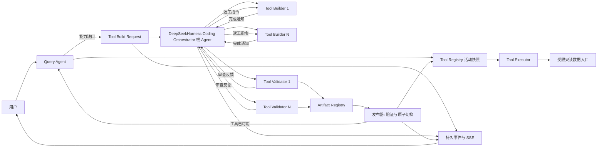

# 业务查询 Agent 自生成工具架构

> 日期：2026-10-29｜状态：设计基线，待按阶段验证｜决策来源：本次产品转向

## 决定与范围

业务查询 Agent 今后不靠人工逐项补齐工具。它先使用当前工具目录；确认缺少查询能力后，提交持久化的 `Tool Build Request`。

独立的 Coding Agent 使用 DeepSeekHarness，在隔离工作区读取 ERP 源码，只编写业务查询工具包。Harness 根 Agent 是 Coding Orchestrator 母 Agent，负责理解需求、拆分能力、委派和决定返工；每个工具由 Tool Builder 编写，再由独立的 Tool Validator 审查并补充对抗用例。Cordis 插件与 Worker 保证次序和证据规则，ERP 独立发布门禁作最终裁决。

全部通过后，Artifact Registry 保存不可变快照，发布器热切换新工具包，查询 Agent 继续原问题。

这一决定取代 [V0 工程布局](../design/business-query-agent-v0-architecture-2026-10-23.md)中“只用固定工具、ERP 不嵌入完整编码 Agent”的约束。已有只读查询、两档数据权限、会话隔离、来源、SSE 和业务模块规则仍是新工具必须遵守的约束。

Coding Agent **只能写工具包源码、工具清单与对应测试**；不能修改业务模块、迁移、权限策略、查询编排器或部署脚本。集成基础设施需要一次性改造，不算 Coding Agent 的可写范围。

DeepSeekHarness 的 SDK、子 Agent、沙箱及 Cordis 组合能力是拟复用的实现。仓库当前没有 Harness 依赖或接线。具体版本、API、进程生命周期和沙箱隔离效果必须在第一阶段用锁定版本实测；不能把现有 `@ai-sdk/deepseek` 模型 provider 当作 Harness。当前 provider 只负责 Query Agent 的模型调用。

## 现有链路的改动点

| 现有位置 | 已有能力 | 必须改的假设 |
| --- | --- | --- |
| `tool-registry.ts` | 6 个领域工具、31 个 operation | 目录来自已激活快照，不再是编译常量 |
| `deepseek-llm-provider.ts` | 按静态目录生成 schema | 同一规划轮使用指定快照的 schema |
| `tool-executor.ts` | 重查档位、校验、分发、限量 | 在闸门后执行快照中的工具实现 |
| `agent-orchestrator.ts` | 工具循环、来源、错误收口 | 区分能力缺口与普通失败；持久化等待和续跑 |
| `state-manager.ts` | run 与事件事务化 | 等待工具时不占模型/并发许可 |
| `stream-transport.ts` | 持久事件重放与 SSE 心跳 | 展示构建进度；断线后仍可恢复 |

静态的 31 个 operation 先作为 `baseline` 快照。保留 6 个领域工具名，新增 operation 归入其一；Query Agent 的模型 schema 和 executor 必须读取**同一个**快照版本。

不能只热改执行器，否则模型看不到新工具；也不能只热改 schema，否则执行器找不到实现。每次工具调用还要保留当前角色重查、输入校验、业务范围校验、输出投影、来源与大小上限。

## 运行拓扑

同一请求缺多个工具时，各工具的 Builder 可并行；每个 Validator 可在对应 Builder 提交后立即审查。某工具的最终验证不能与该工具的编写同时判定完成。整个请求需要的工具作为**一个批次**激活；一个失败则批次不激活，查询 Agent 收到可解释的构建失败。构建可并行，向活动目录发布必须串行，并在发布时检查基线版本冲突。

## 两个 Agent 的接口

`Tool Build Request` 是系统生成的结构化任务，不接受模型或业务数据里的原文指令直接转成文件写入。

最小字段：`request_id`、`query_run_id`、`requester_user_id`、`access_level`、`base_snapshot_id`、`capabilities[]`、`deadline`。每个 capability 包含稳定意图、所属领域、输入与预期输出、业务范围、缺口证据、验收样例和数据敏感级别。

问题原文只供受控分析，不进入工具源码、构建日志或公共 registry。按规范化意图和数据档位去重；相同缺口可共用一个构建任务，但每个等待中的用户仍独立判权和续跑。

Query Agent 只能在目录检索后明确判定“能力不存在”时请求构建。空结果、参数错误、权限拒绝、查询超时、模型误选 operation 均不是构建理由。缺口判断需要一个可校验的结构化结果；现有 `AGENT_TOOL_UNKNOWN` 不能直接触发构建，否则模型拼错名称就会不断生成工具。构建请求先核对工具目录、业务范围与用户档位；低档用户不能借构建请求得到高档工具。

Coding Agent 的 Harness 母 Agent 只接收工具需求和受控源码视图。它不接收生产数据库凭据、用户 Cookie 或部署凭据；模型调用凭据由隔离 worker 限定用途注入。Tool Builder 产出工具实现、清单和可运行用例。

Tool Validator 与 Builder 使用独立子会话，复核输入、权限、来源、空值、分页、提示注入、越权字段与业务口径，并运行测试。Validator 将问题反馈给母 Agent；母 Agent 决定是否交回 Builder 修复。Validator 不能单独放行自己的修改；新修订必须重跑验证。

## 工具包与安全闸门

工具包由 `manifest + implementation + tests` 构成。Manifest 至少声明唯一 `tool/operation`、版本、输入 schema、输出 schema、最低档位、允许的数据源、业务范围策略、最大行数、超时、来源类型和依赖的 ERP 版本。

工具实现只通过宿主提供的**受限只读数据入口**取数；不得获得 PrismaClient、任意 SQL、shell、文件系统、任意 HTTP、环境变量或进程控制。现有 `AgentReadStore` 对生成代码过宽，不能原样注入。

宿主在工具执行前后分别校验身份与结果。只读数据库账号仍保留，作为最后一道拒写闸门。

构建沙箱把 ERP 源码以只读方式挂载，只开放工具包和对应测试的临时写入区；排除 `.env`、密钥、部署目录、会话库和私有数据。Harness 子进程不在 API 主进程中运行，限制网络、CPU、内存、时长与并发。

发布器核对文件路径白名单、依赖锁定、构建产物哈希及测试报告；拒绝越界文件、动态依赖、未声明数据源、任意代码执行入口。Node `vm`、TypeScript 类型检查、代码审查和 Validator 测试都不能单独充当安全隔离。

生成代码进入独立的工具运行进程。进程只拿到当前调用的输入和受限数据入口；宿主负责真正的用户权限与数据范围。`operational/full` 的字段规则由宿主数据入口和结果 schema 强制，不能由工具作者自行声明后自证。

业务范围策略不能固定为销售订单根。订单详情可用本轮订单句柄；月度采购、库存不足等跨单查询需要独立的范围模板，按用户档位、时间窗、记录范围和输出字段限制。第一条纵切先验证订单根，后续必须验证至少一种跨单聚合。

动态工具初期只读、返回窄 `QueryFact`。若需求超出受限数据入口，构建任务失败并记录缺口，不能绕过闸门。这个限制决定了第一版的自动覆盖上限，后续由人扩展受限数据入口的可读范围。

## Artifact Registry 与热切换

Artifact Registry 保存工具包内容哈希、源码提交、Manifest、构建环境、Validator 结果、测试证据、依赖的 ERP 版本、操作者 Agent run、创建时间和状态。快照不可变；状态为 `staged`、`active`、`retired`、`revoked`。

每次发布保留前一个活动快照和回滚指针。一次性装载整个批次，完成健康检查后原子更新活动快照 ID。正在执行的工具调用继续使用其已固定的快照；新调用读取新快照。紧急撤销时阻断该版本的新调用，并终止仍在运行的受影响调用。

“热重载”指**工具运行进程和目录指针切换**，不把新 TypeScript 注入 NestJS 主进程，也不重载整个 ERP。发布失败、健康检查失败或上线后触发错误率/越权告警时，回指上一个快照；失败版本保留证据但不得调用。回滚只改变后续调用，不会抹去已回答的历史事实。每个 `QueryFact` 记录 `snapshot_id` 和 `artifact_id`，供审计与问题复现。

## 状态、续跑与心跳

`agent_run` 新增 `waiting_for_tool`：这表示用户问题仍待答复，但 Query Agent 的模型进程已经结束，进程内并发许可已释放。构建作业另有持久状态和工作租约；不能把它塞进 Query Agent 的 120 秒运行超时。等待中的同一用户仍占用“一个未完成问题”的数据库约束，防止重复提问造成多个构建批次。若产品后来允许用户同时问多题，再调整这条约束。

构建作业状态：`requested → building → validating → staged → activating → active`；任何阶段可进入 `failed/cancelled`。

发布成功后，后台续跑器读取原问题、当前角色和新快照，创建一次新的**计算尝试**，在同一个用户可见 run 上继续 `planning → querying → responding`。续跑必须以 `request_id + snapshot_id` 幂等领取，避免发布通知重复导致多次回答。

用户取消只解除该问题的等待；若多个请求共用构建作业，不能取消其他人的需求。角色撤销或降级时先拒绝续跑，再关闭可见流。

心跳分两层：Harness worker 定期续租持久构建作业，超时由监督器标记失败或重领；SSE 连接继续发注释心跳并从持久事件重放状态。没有活着的 Query Agent 进程时，不设计进程对进程的常驻心跳。

前端断线、刷新或 API 重启均可用原 run ID 找回构建进度。构建期间页面显示“正在补充查询能力”、各工具 Builder/Validator 状态及已发布/失败结果，不展示源码、业务数据或内部测试日志。多 Agent 拓扑的细节交互后续单独设计。

## 必须能失败并恢复

| 场景 | 处理 |
| --- | --- |
| 模型误判缺工具 | 目录二次核对后继续现有工具或要求澄清 |
| Builder/Validator 失败 | 作业终态、记录稳定错误码、原问题显示可重试 |
| Harness 失联 | 租约超时后有限重试；超过预算转失败 |
| 发布时目录已变化 | 重新基于新快照验证并打包，不覆盖活动目录 |
| 新包启动或调用失败 | 保留旧快照，回滚指针并通知等待者 |
| 用户取消、撤权或降档 | 停止该用户续跑；共享构建可继续，结果不越权呈现 |
| API 重启或 SSE 断线 | 从持久作业、run 事件和快照恢复，不重做已完成构建 |

## 尚需实测的假设

- 锁定版 DeepSeekHarness 是否提供可嵌入的 SDK、独立 Builder/Validator 子 Agent、可观察事件和可中断 run；Cordis 组合能力的真实接口与运行约束尚未验证。
- 当前部署形态能否运行真正隔离的构建与工具执行进程，且能限制网络和文件写入；Windows 开发环境与生产 Linux 容器的隔离实现可能不同。
- 受限数据入口能覆盖首批真实生产缺口，同时维持订单根和字段级权限。第一阶段用真实脱敏缺口验证，不凭假设宣称“任意工具可自动生成”。
- 自动激活的发布门槛、错误率阈值和回滚窗口需要用生产流量基线校准。

## 变更记录

- 2026-10-29：按产品转向建立自生成工具架构，明确覆盖并取代 V0 的静态工具与不嵌入 Coding Agent 决策。
- 2026-10-29 阶段一源码核查：上文“尚需实测”中的 SDK、子 Agent、Cordis 与取消语义，按[DeepSeekHarness SDK 接入方案](business-query-agent-deepseek-harness-sdk-phase1-2026-10-29.md)中的已核实事实和待运行验收区分。SDK 实际启动独立 `dsh` 进程；没有 prompt 级取消；`sdk` profile 禁用 HMR；沙箱不能独自承担生产隔离。其余待实测项继续保留。
- 2026-10-30：按产品补充要求明确 Coding Orchestrator 母 Agent。上文拓扑和职责据[根 Agent/父会话源码核查](deepseek-harness-root-parent-activation-2026-10-30.md)修订；插件不替母 Agent 作业务拆分与返工决策。
