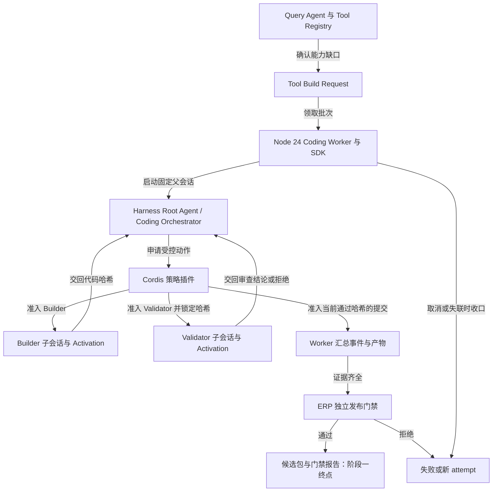

# 阶段一：Harness 接入、返工闭环与候选工具验证计划

> 施工计划｜2026-10-31｜状态：待执行｜依据：固定上游提交 `f3803c96974ad4a94195fb97e5c637e9c2a3afe3` 的源码核查，尚无 SDK 运行实验。

阶段一建议用 **12 个工作日** 完成四个证明：同版 SDK/CLI 能在独立 Worker 启动；母 Agent 能接收 Builder/Validator 反馈并完成返工；隔离环境能生成有权限边界的查询工具；独立门禁能拒绝失效证据和部分成功的批次。最大风险是子会话返工轮次与代码哈希失配。先验证这条链，再投入数据入口和批次构建。施工结果仅到可复核的候选包，不激活生产工具。

**排期假设**：2026-11-02 开始，1 名后端实施者持续投入，另有安全/业务复核人按关口参与；能取得 Node 24 Linux 容器、模型测试凭据和订单 A 包装工序的脱敏样例。日期按周一至周五推算，尚未扣当地节假日；环境或样例延迟则顺延。

## 本阶段的调用链如何运行？

图的主张：一次工具缺口请求经母 Agent 的 Builder/Validator 返工闭环后，只有同一代码哈希的完整证据才能交给 ERP 独立门禁。

图注：母 Agent 决定拆分与返工；Cordis、Worker 和 ERP 门禁分别核对执行次序、运行证据和发布资格。图中的 Query Agent 入口在阶段一由规范化请求样例代替，尚不接入线上缺口触发。

| 层 | 调用与交接 | 阶段一持有的事实 |
| --- | --- | --- |
| ERP 查询层 | Registry/Executor → 构建请求 | 缺口证据、访问档位、原问题；本阶段用样例输入 |
| 构建 Worker | 请求 → SDK `sdk` profile → 父会话 | `request_id`、`attempt_id`、超时、候选目录 |
| Harness 智能层 | 根 Agent → Builder/Validator | 能力拆分、返工决定、父会话反馈 |
| Cordis 规则层 | 受控委派工具 → Activation | 角色、能力、轮次、产物哈希、返工预算 |
| ERP 门禁层 | 候选包 → 路径/权限/测试复核 | 独立测试证据与可发布判定 |

Builder 完成通知使用 `delivery: 'parent'` 返回母 Agent；Validator 对指定哈希写审查报告。
若审查失败，母 Agent 向原 Builder 发返工消息。
原子会话冷恢复成功时复用上下文，但每次 Activation 都有新 `runId`，每次修订都有新哈希。

若整个 Harness runtime 崩溃，Worker 建新 `attempt_id` 和候选目录，从规范化请求重建；旧 attempt 不进入发布门禁。
`run()` 返回只表示根 Agent 一次 idle，Worker 还要用 `session/wait` 和落盘证据核对全树结束。
上述能力来自[根 Agent 与 Activation 核查](deepseek-harness-root-parent-activation-2026-10-30.md)，运行效果仍待验证。

## 哪些风险会改变施工路线？

| 风险 | 触发条件 | 最早验证与失败处置 |
| --- | --- | --- |
| 子会话续接失配 | Builder 冷恢复未唤醒母 Agent，或新轮次无 `runId` | 第 2 关实测返工；失败则新建 Builder 会话并交接结构化产物，仍须重验新哈希 |
| 旧验证套用新代码 | Validator 审 `h1` 后 Builder 写出 `h2` | 第 2 关尝试越序提交；插件与门禁必须拒绝 |
| 根 Agent 工具不可见 | `sdk` profile 未挂载母 Agent 提示或受控工具 | 第 1 关做启动和工具发现 smoke；不通过则先调整 profile/patch |
| 进程隔离不足 | 凭据可读、越界写入或测试时有任意网络出口 | 第 3 关在生产同型 Linux 容器演练；不通过则停止候选验收 |
| 数据入口不够用 | 包装产量需原始 SQL/Prisma 才能取得 | 第 3 关用脱敏样例核对；记录能力缺口，由人扩展受限只读入口 |
| 取消留下工作进程 | SDK 超时后 Harness 或测试子进程仍运行 | 第 4 关强制超时并检查进程树；失败则不能共享 Worker 容器 |
| 批次部分成功 | 两个工具中一个验证失败 | 第 4 关证明整批不提交，旧活动目录不变 |

**待验证清单**：精确版 npm 包与固定源码的一致性；Node 24 下 `sdk` profile 的根 Agent 工具挂载；`delivery: 'parent'` 唤醒；`send_message` 冷恢复；内部 `subagent/start/end` 的 `runId` 桥接。
还需验证多轮返工后的 `session/wait`、Builder/Validator preset 工具面、受限数据入口的业务覆盖，以及 Linux 容器的文件、网络和凭据隔离。
每项在下文关口留下日志或测试报告，不能把源码核查当作验收。

## 1. 需求

- **R-1 同版 Harness 独立运行** — [SDK 接入方案](business-query-agent-deepseek-harness-sdk-phase1-2026-10-29.md)：Node 24 Worker 固定 SDK/CLI 版本并驱动独立 runtime。
- **R-2 母 Agent 统筹双子会话** — 用户决策与[根 Agent 核查](deepseek-harness-root-parent-activation-2026-10-30.md)：根 Agent 拆分能力，Builder 编写，Validator 独立审查并反馈。
- **R-3 失败返工可追溯** — 本轮风险要求与[根 Agent 核查](deepseek-harness-root-parent-activation-2026-10-30.md)：续接 Builder、识别每轮 Activation，旧哈希结果不得放行新修订。
- **R-4 Cordis 与 Worker 强制规则** — [SDK 接入方案](business-query-agent-deepseek-harness-sdk-phase1-2026-10-29.md)：限制角色、次序、预算、等待、取消和候选提交。
- **R-5 源码与数据只读隔离** — [自生成工具架构](business-query-agent-generated-tools-architecture-2026-10-29.md)：只读净化源码、只写候选工具，业务数据走受限只读入口。
- **R-6 真实工具与独立门禁** — [SDK 接入方案](business-query-agent-deepseek-harness-sdk-phase1-2026-10-29.md)：脱敏订单 A 样例产出 `QueryFact`，ERP 独立重验权限、越订单和测试证据。
- **R-7 并行批次与可观察失败** — 用户决策与[总计划](business-query-agent-generated-tools-plan-2026-10-29.md)：多工具并行构建，事件按轮次可追溯，任一失败整批不提交。

## 2. 各项需求怎样验证？

### R-1 同版 Harness 独立运行

- **做法**：锁定 SDK/CLI 为 `0.2.2-alpha.2`，Worker 每批启动独立 runtime；先做初始化、请求、关闭的薄链路。
- **涉及**：Coding Worker、Harness profile、依赖锁定。
- **测试入口**：Worker 启动与关闭入口；这是新增的独立进程接缝。
- **验收**：[ ] 记录精确版本与包哈希；[ ] profile 初始化、请求和关闭成功。
- **难点**：上游发布包、固定源码与 Node 版本的实际兼容性。

### R-2 母 Agent 统筹双子会话

- **做法**：根 Agent 在固定父会话声明能力并委派独立 Builder/Validator；子 Agent 完成结果回到父会话。
- **涉及**：Harness 根 Agent、子 Agent preset、Cordis 委派工具。
- **测试入口**：受控委派工具与父会话事件；沿用 Harness 的 Activation 接缝。
- **验收**：[ ] 母 Agent 收到两个角色的结束通知；[ ] Validator 仅审 Builder 的落盘修订。
- **难点**：`sdk` profile 的根工具挂载和父会话再次唤醒。

### R-3 失败返工可追溯

- **做法**：Validator 拒绝指定哈希后，母 Agent 让 Builder 返工；桥接内部事件记录每轮 `runId`。
- **涉及**：Parent Session、Activation 事件、候选修订记录。
- **测试入口**：一次故意失败的 Builder/Validator 纵切；不新增会话管理器。
- **验收**：[ ] `h1` 拒绝后产生 `h2` 和新轮次；[ ] 将旧哈希的通过记录重放到 `h2` 时被拒。
- **难点**：冷恢复可能复用子 Session，但不会重新发出子 Session 创建通知。

### R-4 Cordis 与 Worker 强制规则

- **做法**：母 Agent 选择动作，插件校验动作前置条件；Worker 核对全树完成并在取消时清理进程。
- **涉及**：Cordis 策略插件、Coding Worker、作业事件。
- **测试入口**：受控委派工具和 Worker 作业入口。
- **验收**：[ ] 越序委派与缺验证提交被拒；[ ] 超时后无残留构建子进程。
- **难点**：`run()` idle、`session/wait` 与通知乱序不能混成同一个完成信号。

### R-5 源码与数据只读隔离

- **做法**：净化源码只读挂载，仅候选目录可写；工具通过宿主受限入口读取脱敏业务数据。
- **涉及**：Linux 构建容器、源码视图、受限数据入口。
- **测试入口**：容器越界实验和工具数据入口。
- **验收**：[ ] 凭据不可读、业务源码不可写；[ ] 工具无法取得原始 SQL/Prisma 通道。
- **难点**：Harness preset 和内建 sandbox 不构成操作系统安全边界。

### R-6 真实工具与独立门禁

- **做法**：用订单 A 包装工序样例生成工具、测试与报告；ERP 侧独立核对哈希和权限测试。
- **涉及**：工具候选包、Tool Executor/`QueryFact` 契约、ERP 发布门禁。
- **测试入口**：候选包进入独立门禁的入口。
- **验收**：[ ] 正确返回每日产量和累计数量并带来源；[ ] 跨订单、降档和写库用例被拒。
- **难点**：现有查询工具数据入口不能直接交给生成代码。

### R-7 并行批次与可观察失败

- **做法**：各能力独立目录并行 Builder，逐项验证；Worker 将 Session 与 Activation 事件归一化。
- **涉及**：批次作业、构建事件、候选包汇总。
- **测试入口**：双能力批次构建入口。
- **验收**：[ ] 两个 Builder 可并行且事件能按轮次定位；[ ] 任一能力失败时整批无候选。
- **难点**：并行写入冲突及重复通知导致的重复提交。

## 3. 阶段一怎样排期和验收？

| 内部关口 | 基线日期 | 工作日 | 首要证明 |
| --- | --- | ---: | --- |
| 第 1 关：Runtime 可启动 | 2026-11-02—11-03 | 2 | 锁版 SDK/CLI 可启动、请求、关闭 |
| 第 2 关：失败能返工 | 2026-11-04—11-06 | 3 | `h1` 拒绝后 `h2` 重验，旧证据被挡 |
| 第 3 关：工具可安全取数 | 2026-11-09—11-12 | 4 | 脱敏真实缺口返回合规 `QueryFact` |
| 第 4 关：批次可收口 | 2026-11-13、11-16—11-17 | 3 | 双工具并行、整批拒绝、超时清理 |

### 第 1 关：Runtime 可启动（2 个工作日）

**覆盖**：R-1 同版 Harness 独立运行、R-2 母 Agent 统筹双子会话的启动条件。

**目标**：运行一次规范化构建请求，能观察到固定父会话和安全退出的 Harness 进程。

**任务**

- 打通 Worker 启动 SDK、创建父会话、发送样例请求和关闭 runtime 的薄链路。
- 锁定 SDK 与 CLI 的精确版本及包哈希，核对 Node 24 运行环境。
- 装载 `sdk` profile 与最小 patch，核对母 Agent 工具可见性。
- 保存启动日志、配置清单和退出状态。

**证据**：一次可重复的启动 smoke、配置快照与退出码；工具缺失或版本不符时关口失败。

**回退**：撤掉试验 Worker 配置，保留现有 Query Agent；调整 profile 后重跑本关。

**本关不做**：生成真实工具和改动 ERP 查询运行态。

### 第 2 关：失败能返工（3 个工作日）

**覆盖**：R-2 母 Agent 统筹双子会话、R-3 失败返工可追溯、R-4 Cordis 与 Worker 强制规则。

**目标**：演示母 Agent 收到 Validator 拒绝，唤醒 Builder 修复，并只接受新哈希的重新验证。

**任务**

- 打通根 Agent 委派 Builder、Validator、反馈母 Agent 和返工的薄链路。
- 接入受控委派规则，核对能力声明、角色、次序和返工预算。
- 记录子 Session 与每轮 Activation `runId`，核对冷恢复后的事件。
- 注入 `h1` 拒绝、`h2` 重验及旧哈希通过记录重放的反例。
- 核对父会话唤醒、`session/wait` 与落盘报告的完成判定。

**证据**：父会话和两轮 Activation 记录、`h1/h2` 哈希、审查报告、旧证据拒绝结果。

**回退**：若冷恢复不稳定，用新 Builder 子会话加结构化交接重跑；仍按新哈希重新验证。

**本关不做**：把会话记录当作发布证明，或接入生产工具目录。

### 第 3 关：工具可安全取数（4 个工作日）

**覆盖**：R-5 源码与数据只读隔离、R-6 真实工具与独立门禁，并强化 R-4 Cordis 与 Worker 强制规则。

**目标**：订单 A 包装工序工具在受限入口上返回每日与累计产量；越订单和越权请求失败。

**任务**

- 打通脱敏请求、候选工具、受限数据入口和独立门禁的薄链路。
- 建立净化源码只读视图和仅工具候选可写的 Linux 容器。
- 生成包装工序工具、manifest、对抗测试和来源报告。
- 验证跨订单隔离、降档、拒写、输出限额和文件范围。
- 独立复跑测试并核对候选哈希与 ERP 源码基线。

**证据**：可运行 `QueryFact`、对抗测试结果、容器越界实验和独立门禁报告。

**回退**：任何隔离或数据范围缺口使候选保持失败；只扩展受限入口后重新测试。

**本关不做**：给生成工具直接提供 Prisma、原始 SQL、生产凭据或写入能力。

### 第 4 关：批次可收口（3 个工作日）

**覆盖**：R-7 并行批次与可观察失败，并强化 R-3 失败返工可追溯、R-4 Cordis 与 Worker 强制规则、R-6 真实工具与独立门禁。

**目标**：两个能力并行生成候选；一个失败时整批不能提交，超时后无遗留进程。

**任务**

- 打通双能力并行构建、逐项验证和整批候选汇总的薄链路。
- 将 SDK 通知和内部 Activation 事件映射到统一作业进度。
- 注入单能力失败、重复通知、Worker 失联与强制取消。
- 核对整批拒绝、进程树清理和新 attempt 的候选隔离。
- 汇总固定版本、测试报告、失败反例和后续阶段接口清单。

**证据**：双工具事件序列、整批拒绝记录、超时进程检查和最终阶段一验收报告。

**回退**：任一能力失败即终止该批次候选；保留旧工具目录并按新 attempt 重试。

**本关不做**：Artifact Registry 激活、Query Agent 持久等待或前端拓扑页面。

## 阶段一通过后才进入什么工作？

阶段一通过条件是四关证据齐全，且独立门禁对当前候选哈希给出通过结果。
下一阶段才接 Query Agent 的结构化缺口触发、`waiting_for_tool`、持久作业与续跑。
再后续处理 Artifact Registry、原子激活、回滚和页面工作态。
现有运行代码里，`AGENT_TOOL_UNKNOWN` 是可恢复工具错误，不能直接视作缺口事件；状态管理器也尚无 `waiting_for_tool`。
这两个接口变更不计入本阶段 12 个工作日。

**开放问题及解法**：若脱敏生产样例所需字段没有受限入口，业务与安全复核人需确认最小可读字段后再扩入口；若模型调用或容器环境不能在 2026-11-02 前就绪，排期从环境可用日顺延。阶段一不承诺生产热切换，也不允许修改 ERP 其他业务模块。

## 变更记录

- 2026-10-31：新增阶段一流程图、风险与待验证点、按证据关口排序的 12 工作日施工计划。
